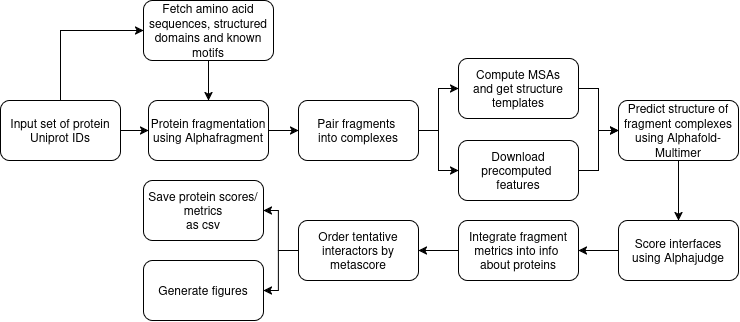

# chromatin-ppi-pipeline

The `chromatin-ppi-pipeline` is a computational workflow for protein-protein interaction identification and validation 
built on [Alphapulldown v.2](https://github.com/KosinskiLab/AlphaPulldown) using the Alphafold-Multimer protein folding backend. 
It aims to adress complications in interaction prediction related to the large size and IDR content of chromatin-associated proteins by dividing input proteins into smaller fragments in a structure aware manner. 


## Pipeline structure


This section offers a logical overview of the pipeline's functions. Details and command syntax can be found in the [Usage](#usage) section.

On the input the pipeline expects a `.csv` file with a set of proteins specified by Uniprot IDs.
The [Alphafragment](https://github.com/IngeliseH/AlphaFragment) Python package is then used to fetch the amino acid sequences and structural features (known domains and motifs) of the specified proteins from Uniprot and Alphafold Protein Structure database.
The proteins are divided into fragments preferentially placing breaks outside of structured domains and introducing overlaps to recover the context of break loci.

On the fragmentation step a bait protein is specified by the user. Fragments are then paired into fragment-fragment complexes for structure predictions such that each fragment of the bait encounters every fragment of every interactor candidate.

Before proceeding with structure prediction protein features are required. These are per-protein `.pkl` files including serialized information about the multiple sequence alignments (MSAs), structure templates and other information for the folding backend (for more details refer to [Alphapulldown2 documentation](https://github.com/KosinskiLab/AlphaPulldown/wiki/Run-AlphaPulldown-Python-Command-Line-Interface)).
<details>
<summary>There are two options for obtaining features</summary>

- compute features locally (possible for any protein)
- download precomputed features from Alphapulldown features database (only possible for a set of model organisms selectable in the global configuration of the pipeline)

</details>


Once all features are available the structures of all fragment-fragment complexes are predicted using the Alphafold-Multimer folding backend.

The resulting structures are analyzed by the [Alphajudge](https://github.com/KosinskiLab/AlphaJudge) Python package generating a summary with several metrics characterizing each interface including unified Alphafold-internal metrics (PAE, pLDDT), interface biophysics (e.g. number of hydrogen bonds, ) and derived scores (e.g. pDockQ).

To allow for comparison of interactions the information about individual fragment-fragment complexes is summarized for fragment pairs originating from the same pair of proteins using a softmax function yielding a value of the given metric representing the overall protein-protein interaction.
By default this is performed for the integrative **metascore** metric reported by Alphajudge which is used to rank the interactions.
Optionally any other numerical metric reported by Alphajudge can be specified by the user to also be summerized from fragments to whole proteins and reported for later analysis. 

To simplify the analysis of results exploratory figures showing the ranking by metascore and the distribution of metascores on the dataset are generated.
Analysis of individual structures is possible through the provided [session scripts](#structure-visualization-scripts-for-ucsf-chimerax) for the UCSF ChimeraX molecular visualization software allowing the user to quickly view any given interface.


## Installation & dependencies


### Dependencies
The `chromatin-ppi-pipeline` is designed for the Czech [Metacentrum](https://metavo.metacentrum.cz/en/index.html) computational infrastructure.
Other platforms are not officially supported.<details>
<summary>Details:</summary>

The pipeline assumes the OpenPBS scheduling system configured as on Metacentrum, 
software and data resources available at expected locations etc.

The installation of all software dependencies which are not natively available at Metacentrum and are to be installed by the user is described below.
</details>


### Installation instructions

Clone this repository:
```
git clone https://github.com/kalinapetrcuni/chromatin-ppi-pipeline.git

# set the permissions of pipeline scripts to be executable
chmod +x chromatin-ppi-pipeline/src/pipeline_scripts/*
```


#### Global configuration
The file `global_config.sh` contains all global configurations which __need to be set before running the pipeline__.
These parameters set the behaviour of the pipeline across all subsequent runs and direct the pipeline towards software resources.
Edit it to set the variables accordingly:
```
nano chromatin-ppi-pipeline/src/pipeline_scripts/global_config.sh
```

**Variables and how to set them:**

<details>
<summary>ALPHAFRAGMENT_VENV = path to a Python virtual enviroment with Alphafragment installed</summary>

To create the enviroment run:
```
# clone the Alphafragment repository
git clone https://github.com/IngeliseH/AlphaFragment.git

# load the Python module on Metacentrum
module load python

# create a new virtual enviroment called "alphafragment_venv" and activate it
python -m venv alphafragment_venv

source alphafragment_venv/bin/activate

# move into the Alphafragment repository and install 
cd AlphaFragment/

pip install .

# deactivate the enviroment
deactivate
```

Store the path to the absolute path to the `alphafragment_venv` directory in the variable. 
You can get it using the following commands:
```
cd ../alphafragment_venv
pwd
cd ..
```

---

</details>

<details>
<summary>ALPHAJUDGE_VENV = path to a Mamba enviroment with the Alphajudge Python package</summary>

To create the Mamba enviroment run:
```
# load the Mamba module on Metacentrum
module load mambaforge

# create the enviroment
mamba create -n alphajudge_venv python=3.12

# activate the enviroment
mamba activate alphajudge_venv

# istall the Alphajudge package
pip install alphajudge

# deactivate the enviroment
mamba deactivate
```

Store the absolute path to the enviroment directory in the variable. 
The enviroment should be located here:
```
cd ~/.conda/envs/alphajudge_venv
pwd
```

---

</details>

<details>
<summary>MINIO = path to the MinIO client binary used to download precomputed features</summary>

Download the `mc` binary according to the [MinIO website](https://docs.min.io/aistor/reference/cli/#install-mc). 
Place it somewhere the pipeline can reach at execution (e.g. somewhere in your home directory at Metacentrum).
Store the absolute path to the file in the variable.

---
</details>


<details>
<summary>ORGANISM = organism selection for precomputed feature download (default = Homo_sapiens)</summary>

__Precomputed features are available for the following organisms:__
Homo_sapiens
Escherichia_coli
Mus_musculus
Drosophila_melanogaster
Danio_rerio
Caenorhabditis_elegans
Dictyostelium_discoideum
Methanocaldococcus_jannaschii
Rattus_norvegicus
Saccharomyces_cerevisiae
Oryza_sativa
Zea_mays
Glycine_max
Arabidopsis_thaliana

Each run of the pipeline can only use precomputed features for one organism. As of now it is not possible to combine proteins from several organisms in a single prediction if you wish to use precomputed features.

---
</details>

<details>
<summary>BETA_PARAM = beta parameter for softmax function (default = 5)</summary>

used to integrate fragment metrics into protein metrics 
- score contributions of each fragment pair originating from the same pair of proteins are averaged. The weights in this average are determined by a parametrized softmax function of their scores (better scoring fragments influence the final protein score more).
- the beta parameter influences whether the weights are more evently distributed across the fragments (low beta) or whether most of the weight is on the top scoring fragment pair (high beta). 

---
</details>


Once dependencies are installed and global configuration is set the pipeline is ready to be used.

## Usage

### Specify the dataset to operate on:
On input the pipeline expects a `csv` file specifying a set of proteins.

Example [test_names_and_ids.csv](./test_names_and_ids.csv):
```
name,accession_id
CalgranulinA,P05109
CalgranulinB,P06702
```

<details>
<summary>Input format details:</summary>

The file should contain 2 columns.
Each line corresponds to one protein in the dataset.
The first column `name` can contain an arbitrary user defined name for the protein. It should be unique for each protein and UTF-8 compatible.
The second column `accession_id` should contain a valid Uniprot ID for the protein.
</details>

### Initiatilizing the pipeline
The pipeline is designed to separate each run (each instance of going through the pipeline with a specified dataset) into a separate directory to make it easy to later determine which settings were used for a given set of calculations.

The script `init_pipeline_structure.sh` generates the directory structure for running the pipeline on a dataset called `test` using the specified input csv.
The structure is generated in the current working directory starting in a subdirectory matching the specified dataset-name + _dataset. 
```
init_pipeline_structure.sh
   -h | --help    display the help message and quit
   --dataset-name DATASET_NAME 
   --input-csv PATH_TO_INPUT_CSV
```


### Running the pipeline run
Navigate into the dataset directory structure job working directory. All following steps of the pipeline should be run from this directory.
```
cd <your-dataset-name>_dataset/job_work_dir/
```

##### Protein fragmentation
Specify the `name` of the bait protein (interaction of which with all others in the dataset are going to be predicted) as the first positional argument.

```
../scripts/run_protein_fragmentation.sh <your_name_of_bait_protein>
```
##### Compute or download features 
Computing features locally is computationally intensive and thus has to be submitted as a job to the scheduler
```
qsub ../scripts/run_create_features.sh
```
Alternatively it is possible to download precomputed features (if you are working with a supported organism see  [Global configuration](#global-configuration) variable ORGANISM).
```
../scripts/run_download_features.sh
```

##### Predict structures of complexes
Computationally intesive (GPU required) -> submitted to the job scheduler

```
qsub ../scripts/run_multimer_jobs.sh
```

#### Analyze structures
```
../scripts/run_alphajudge_analysis.sh
```

#### Generate results summary and figures
TODO: bug discovered, to be fixed soon

### Structure visualization scripts for UCSF ChimeraX
To simplify further analysis of individual complexes 
we provide 2 scripts to visualize their structures in the ChimeraX software.

The scripts automatically color each interacting partner to distinguish them, color the interface residues and show residue atoms.
The script `view_full_structure.cxc` shows the whole protein complex providing context but potentially obscuring the view of the interface.
The script `view_interface.cxc` shows just the interface residues and their immediate surroundings. 
Usage requires graphical access and an installation of UCSF ChimeraX.

Usage syntax:
```
chimerax <path/to/your>/structure.pdb view_interface.cxc
```
```
chimerax <path/to/your>/structure.pdb view_full_structure.cxc
```

## Contacts and support
TODO: to be added soon


This pipeline was developed as part of a bachelor's thesis on Charles University (Prague). 


